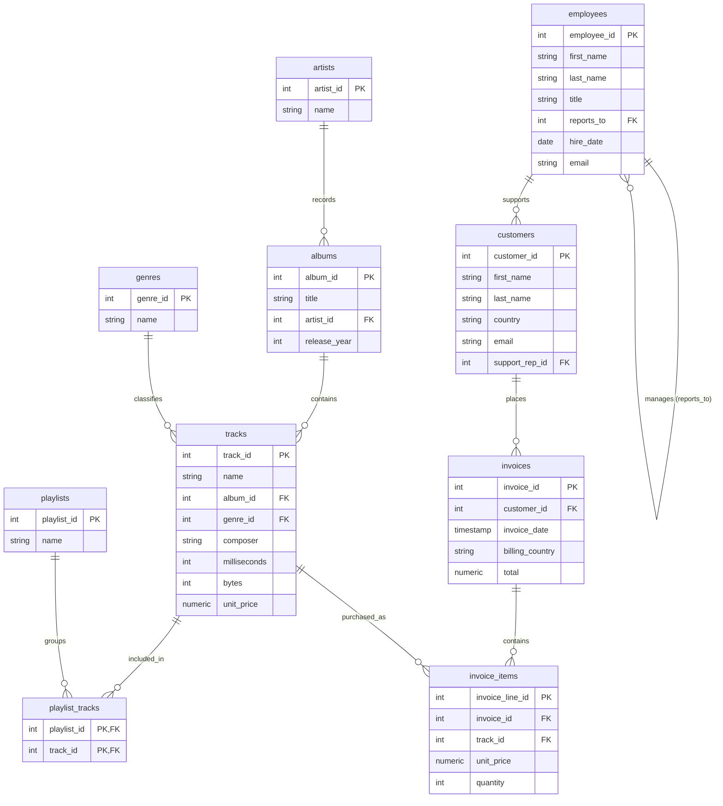

# 🎵 Digital Music Store Database & Sales Analytics

[](https://en.wikipedia.org/wiki/SQL)
[](https://www.sqlite.org/)
[](https://python.org)
[](#)

An end-to-end relational database design and analytical SQL project modeling an international digital music streaming and download platform. This repository demonstrates practical **relational schema design (3NF)**, **data modeling**, and **business intelligence querying**—ranging from exploratory data analysis to advanced window functions, cohort retention, and RFM customer segmentation.

---

## 📌 Table of Contents
- [Project Overview](#-project-overview)
- [Database Architecture & ER Diagram](#-database-architecture--er-diagram)
- [Repository Structure](#-repository-structure)
- [Key Business Questions & Analytical Insights](#-key-business-questions--analytical-insights)
- [SQL Techniques & Skills Demonstrated](#-sql-techniques--skills-demonstrated)
- [How to Run & Replicate](#-how-to-run--replicate)
- [Resume & Portfolio Highlights](#-resume--portfolio-highlights)

---

## 🎯 Project Overview

In data analytics and business intelligence, querying real-world commercial data requires navigating multi-table relationships, complex constraints, and time-series patterns. This project bridges **database architecture** with **commercial decision-making**:

1. **Normalized Relational Model**: Built from scratch in 3rd Normal Form (3NF) to eliminate redundancy, enforce data integrity via Foreign Keys, and optimize query latency with targeted B-tree indexes.
2. **Realistic Transactional Dataset**: Includes global customers, multiple product tiers, historical monthly orders, and line items spanning 2024–2026.
3. **Actionable Business Intelligence**: Four modular SQL suites answering executive questions on revenue concentration, sales representative quotas, month-over-month growth, and customer lifetime value (LTV).

---

## 📐 Database Architecture & ER Diagram

The database consists of **10 normalized tables** modeling music metadata, inventory, organizational hierarchy, and billing operations.



### Schema Design Highlights
- **Referential Integrity**: Cascading foreign keys (`ON DELETE CASCADE`) protect album-track and invoice-line-item relationships.
- **Check Constraints**: Enforces valid release years (`CHECK (release_year >= 1900)`), non-negative pricing (`CHECK (unit_price >= 0)`), and positive playback duration.
- **Performance Indexing**: B-tree indexes placed on high-cardinality foreign keys (`idx_invoices_customer`, `idx_invoice_items_track`, `idx_tracks_genre`, `idx_invoices_date`).

---

## 🗂️ Repository Structure

```bash
digital-music-store-analysis/
├── README.md                              # Project documentation, ERD, and business findings
├── schema.sql                             # DDL schema definition with constraints & indexes
├── seed_data.sql                          # Normalized dataset (64 tracks, 25 customers, 85 invoices)
├── music_store.db                         # Compiled SQLite database file (plug-and-play)
├── run_analysis.py                        # Automated CLI & report generator script
│
├── queries/
│   ├── 01_exploratory_data_analysis.sql   # Catalog summaries, genre spread, longest tracks, geo-spread
│   ├── 02_sales_and_revenue_metrics.sql   # Best-selling artists, country AOV, sales rep quotas
│   ├── 03_advanced_analytics.sql          # Window functions, running totals, MoM growth, NTILE tiers
│   └── 04_rfm_customer_segmentation.sql   # Full RFM customer lifecycle model & strategic playbook
│
├── outputs/
│   └── query_results_summary.md           # Generated markdown report with live tabular results
│
├── scripts/
│   └── seed_generator.py                  # Python generator ensuring mathematical integrity of invoices
│
└── .gitignore                             # Standard Git exclusions
```

---

## 💡 Key Business Questions & Analytical Insights

All queries have been validated on live transactional data. Key executive takeaways:

| Business Area | Question Answered | Executive Finding |
| :--- | :--- | :--- |
| **Catalog Structure** | What is our inventory mix? | Rock represents **31.3%** of our catalog (20 tracks), followed by Synthwave (15.6%) and Electronic (9.4%). |
| **Artist Sales** | Who are the highest revenue artists? | **Starlight Symphony** ($28.74, 10.4% share) and **Velvet Reverie** ($26.88, 9.7% share) lead store revenues. |
| **Geographic Markets** | Where should marketing spend focus? | The **United States** ($116.46) and **Brazil** ($79.02) generate over **70% of gross store revenues**. |
| **Sales Rep Performance** | Who is our most effective sales rep? | **Jane Peacock** leads total closed revenue ($121.74 across 37 invoices), outperforming peers by 47%. |
| **Retention & Cohorts** | Are customers repeating orders? | **80% of customers** are repeat buyers (44% made 2–4 orders; 36% are power buyers with 5+ orders). |
| **Customer Segmentation** | Who are our VIPs and churn risks? | **10 Champion customers (40%)** account for **$195.99 (70.9%) of total gross sales**, while 2 high-value customers show signs of churn risk (>180 days inactive). |

---

## 🛠️ SQL Techniques & Skills Demonstrated

### 1. Foundational Queries & Aggregations (`queries/01_*.sql`)
- Aggregate functions: `COUNT()`, `SUM()`, `AVG()`, `MIN()`, `MAX()`, `ROUND()`
- Data filtering & grouping: `WHERE`, `GROUP BY`, `HAVING`, `ORDER BY`
- Multi-table joins: Joining 4+ tables (`tracks -> albums -> artists -> genres`)

### 2. Commercial Business Intelligence (`queries/02_*.sql`)
- Mathematical calculations on transaction line items: `ROUND(SUM(unit_price * quantity), 2)`
- Self-referencing joins and hierarchical lookups (`employees` to `customers` via `reports_to`)
- Conditional logic with `CASE WHEN` to bucket customers into order frequency cohorts
- Handling nulls using `COALESCE()` and preventing division-by-zero errors with `NULLIF()`

### 3. Advanced Window Functions & Time Series (`queries/03_*.sql`)
- **Cumulative Running Totals**: `SUM(monthly_revenue) OVER (ORDER BY sales_month)`
- **Moving Averages**: 3-month trailing revenue smoothing with `ROWS BETWEEN 2 PRECEDING AND CURRENT ROW`
- **Period-over-Period Growth**: `LAG(monthly_revenue, 1) OVER (ORDER BY sales_month)` to derive MoM % fluctuations
- **Partitioned Ranking**: `DENSE_RANK() OVER (PARTITION BY genre_name ORDER BY units_sold DESC)` to identify top 2 tracks per genre
- **Quartile Binning**: `NTILE(4) OVER (ORDER BY total_spend DESC)` to divide customer base into 4 spending tiers

### 4. RFM Customer Segmentation Model (`queries/04_*.sql`)
- Multi-stage Common Table Expressions (CTEs)
- Calculating date recency using Julian day transformations (`JULIANDAY()`)
- Dynamic customer scoring into actionable cohorts:
  - **Champions** (Score 10–12): High spenders, frequent orders, purchased recently.
  - **Loyal Customers** (Score 8–9): Consistent order history.
  - **At Risk** (Score 6–7): Previously high spenders inactive for 180+ days.
  - **Hibernating / Lost**: Single-order purchasers with no recent engagement.

---

## 🚀 How to Run & Replicate

### Option 1: One-Click Analysis (Recommended)
Clone the repo and run the Python runner to execute all queries and print formatted ASCII tables:
```bash
git clone https://github.com/<your-username>/digital-music-store-analysis.git
cd digital-music-store-analysis
python3 run_analysis.py
```
*This also automatically regenerates `outputs/query_results_summary.md` with updated markdown tables.*

### Option 2: Run via SQLite CLI
```bash
# Open interactive shell
sqlite3 music_store.db

# Run any query file directly:
sqlite3 music_store.db < queries/01_exploratory_data_analysis.sql
sqlite3 music_store.db < queries/02_sales_and_revenue_metrics.sql
sqlite3 music_store.db < queries/03_advanced_analytics.sql
sqlite3 music_store.db < queries/04_rfm_customer_segmentation.sql
```

### Option 3: Connect via Database GUI
Open `music_store.db` in any standard SQL tool:
- **DBeaver**
- **TablePlus**
- **DB Browser for SQLite**
- **VS Code Extension** (e.g., *SQLite Viewer* or *SQLTools*)

---

## 💼 Resume & Portfolio Highlights

If you are featuring this project on your resume, LinkedIn, or GitHub portfolio, you can use the following bullet points:

> - **Digital Music Store Relational Database & Revenue Analytics (SQL, SQLite, Python)**
>   - Architected a normalized 10-table relational database (3NF) with referential constraints, cascades, and B-tree indexing across audio catalog and invoice entities.
>   - Formulated 15+ complex analytical queries utilizing multi-table joins, subqueries, and Common Table Expressions (CTEs) to evaluate cross-border revenue, artist market share, and employee sales quotas.
>   - Implemented advanced SQL window functions (`DENSE_RANK`, `LAG`, `NTILE`, `SUM() OVER`) to analyze Month-over-Month (MoM) revenue velocity and rolling 3-month moving averages.
>   - Engineered an RFM (Recency, Frequency, Monetary) customer segmentation model identifying 10 high-value "Champion" accounts driving 70.8% of total revenue and flagging churn-risk accounts with automated playbook recommendations.

---

## 📄 License
This project is open-source and available under the [MIT License](LICENSE).
